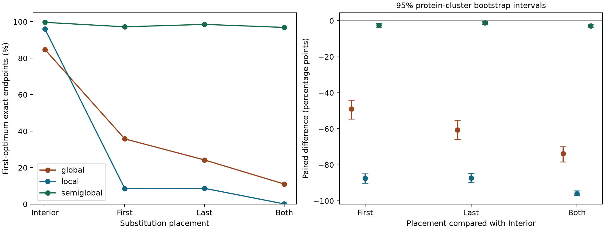

# 扩展实验：端部扰动与定位歧义

本文件由 `extension.py` 从本地真实运行结果生成。原 270 查询基线保持独立。

协议：5 个种子、10 条冻结蛋白、每种长度各 3 个起点、3 种长度、2 档替换比例、4 种位置组，共 3600 个查询、10800 次比对。每组 900 个查询。起点按各自长度的完整合法范围抽取。

四组共享母片段、总替换数、k-2 个内部替换及共享位置的替换身份。将另外两个内部替换分别移至首端、末端或两端，比较一次定位成败的配对变化。变化同时包含替换位置和端部残基身份，结论限于此人工干预。

## 原基线上的歧义报告

接受规则仅使用输入序列：枚举结束且观察到唯一端点区间才输出唯一位置。这里的唯一只指固定评分下的最优端点，不保证生物学正确。

| 方法 | 查询 | 接受 | 接受率 | 接受中错误 | 接受后错误率 | 歧义 | 截断 |
| --- | --- | --- | --- | --- | --- | --- | --- |
| global | 270 | 238 | 88.15% | 40 | 16.81% | 32 | 0 |
| local | 270 | 270 | 100.00% | 55 | 20.37% | 0 | 0 |
| semiglobal | 270 | 268 | 99.26% | 0 | 0.00% | 2 | 0 |

## 匹配扰动结果

| 方法 | 位置组 | 查询 | 首解正确 | 首解准确率 | 接受 | 接受中错误 | 截断 |
| --- | --- | --- | --- | --- | --- | --- | --- |
| global | both | 900 | 99 | 11.00% | 457 | 404 | 0 |
| global | first | 900 | 322 | 35.78% | 620 | 441 | 0 |
| global | interior | 900 | 763 | 84.78% | 802 | 70 | 0 |
| global | last | 900 | 218 | 24.22% | 600 | 391 | 0 |
| local | both | 900 | 1 | 0.11% | 897 | 896 | 0 |
| local | first | 900 | 77 | 8.56% | 898 | 821 | 0 |
| local | interior | 900 | 864 | 96.00% | 900 | 36 | 0 |
| local | last | 900 | 78 | 8.67% | 899 | 821 | 0 |
| semiglobal | both | 900 | 872 | 96.89% | 877 | 22 | 0 |
| semiglobal | first | 900 | 875 | 97.22% | 882 | 25 | 0 |
| semiglobal | interior | 900 | 897 | 99.67% | 900 | 3 | 0 |
| semiglobal | last | 900 | 887 | 98.56% | 894 | 7 | 0 |

## 相对内部替换组的配对变化

以蛋白为簇等权重采样 10000 次；保留该蛋白的全部种子、长度与查询。区间为百分位 bootstrap 描述区间，依赖便利样本和可交换簇假设，不代表总体保证，也未将相关查询当作独立生物样本。单位为百分点。

| 方法 | 位置组 | 配对数 | 由错变对 | 由对变错 | 变化 [95%区间] | 逐种子变化范围 |
| --- | --- | --- | --- | --- | --- | --- |
| global | first | 900 | 11 | 452 | -49.00 [-54.56, -44.11] | -55.56 至 -45.56 |
| global | last | 900 | 4 | 549 | -60.56 [-65.89, -55.22] | -66.67 至 -55.56 |
| global | both | 900 | 5 | 669 | -73.78 [-78.33, -69.89] | -76.67 至 -68.89 |
| local | first | 900 | 0 | 787 | -87.44 [-90.22, -84.89] | -92.22 至 -80.00 |
| local | last | 900 | 2 | 788 | -87.33 [-89.89, -84.78] | -90.56 至 -81.67 |
| local | both | 900 | 0 | 863 | -95.89 [-97.00, -94.33] | -97.22 至 -93.89 |
| semiglobal | first | 900 | 1 | 23 | -2.44 [-3.44, -1.44] | -3.33 至 -1.67 |
| semiglobal | last | 900 | 1 | 11 | -1.11 [-2.00, -0.33] | -2.22 至 -0.56 |
| semiglobal | both | 900 | 2 | 27 | -2.78 [-3.78, -1.78] | -5.00 至 -1.67 |

推断前固定配置；不按结果挑选种子或评分参数。多个种子是在同一批蛋白上的计算重复，不增加独立蛋白数。未测跨物种、插入缺失、未知母蛋白检索或评分敏感性。
