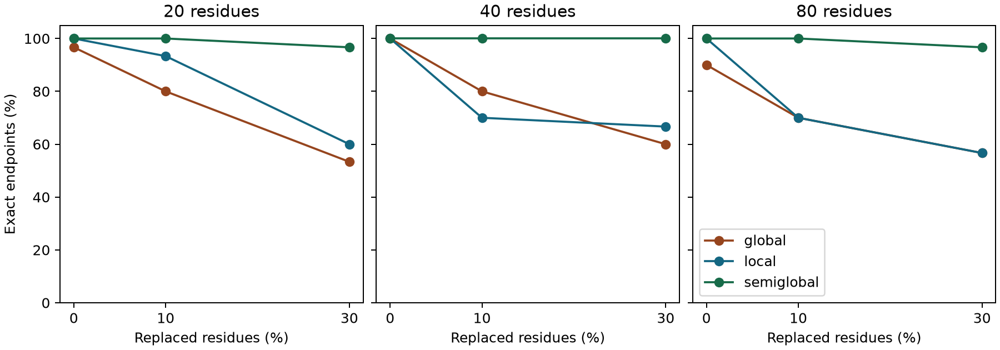
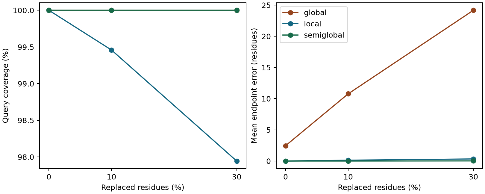
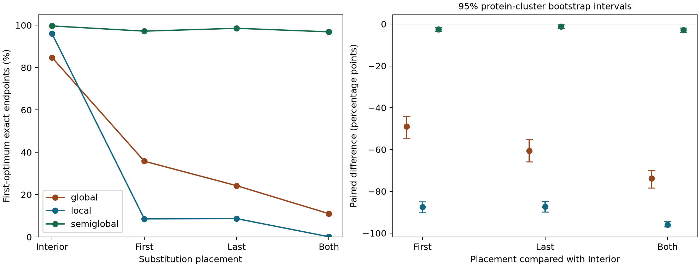

# 蛋白质片段定位中的端部扰动与位置歧义：三种比对策略的可复现研究

## 摘要

给定蛋白质片段及其母序列，定位任务要求同时找回片段的起止位置。本文使用十条人类蛋白质，先在 270 个含人工替换的查询上比较严格全局、局部与半全局比对，首个最优解的精确定位数分别为 206、215 和 268。进一步构造五个种子下的 900 组匹配片段，保持替换数量与背景替换相同，将两个内部替换移至首端、末端或双端，形成 3,600 个扩展查询。仅内部替换与双端替换条件下，局部比对精确定位率分别为 96.00% 和 0.11%，半全局分别为 99.67% 和 96.89%。局部方法双端干预的配对变化为 −95.89 个百分点，按母蛋白聚类的 bootstrap 95%描述区间为 [−97.00, −94.33]。工程实现还通过有界枚举报告唯一位置、等分歧义、无命中或枚举未完成。在原基线上，半全局方法将两次首解偏差标为歧义，其余 268 次均正确；扩展实验仍存在唯一位置错误。研究提供配对扰动设计、歧义报告与可复现工程，结论限于当前人工替换、已知母蛋白及固定评分条件。

**关键词**　蛋白质片段定位；端部替换；半全局比对；位置歧义；可复现研究

## 1　研究问题

假设拿到一段短的氨基酸序列，同时知道它来自哪条蛋白质，现在要回答的是：它从第几个残基开始，到第几个残基结束？比较两条完整蛋白质时，序列两端通常也会进入评分；在片段定位中，母蛋白天然比片段长，多出来的两端会如何影响预测？经典全局比对与局部比对为这个问题提供了两种不同的优化目标。前者将两条序列从头到尾纳入比对，后者寻找得分最高的局部区域。[1][2]

预实验展示了两种目标的差别。人血红蛋白 α 亚基 P69905 的第 21–40 位是一个 20 残基片段。两种方法都完整找回了它；局部得分为 105，全局得分为 −35。全局比对需要在片段两侧放入长度为 20 和 102 的空位，罚分合计为 140。位置相同，得分相差很大。由此，本文把评价对象定为**预测位置与真实位置之间的差距**，并加入适合短查询的半全局方法作为对照。[3][4]

短查询全长对应长目标局部区域的目标已用于 GLSEARCH 等工具。[4] 本文在已有比对方法之上开展课程研究，工作集中于两个问题：在替换总数相同时，端部替换对端点定位有多大影响；当多个最优路径对应不同位置时，软件应如何表达这种歧义。对应的贡献是可追溯的匹配扰动设计，以及与首解准确率分开评价的定位报告规则。这些属于实验设计与软件实现层面的改进。

## 2　实验设计

**数据与查询。** 选取 UniProtKB/Swiss-Prot 中 10 条具有不同功能的人类蛋白质，包含人血红蛋白 α 亚基、铁蛋白重链、碳酸酐酶 2 等。实际长度为 142–417 个残基。每条序列有独立登录号，原始 FASTA、版本、下载日期与 SHA-256 均可追溯。该样本是为课程实验选取的便利样本。[5] [数据清单](data/study_manifest.csv)

固定种子 20261109。每条蛋白质从能容纳最长片段的起点中无放回抽取 3 处，在每处截取 20、40、80 个残基；针对每个长度，分别将 0%、10%、30% 的位置替换为均匀抽取的其他标准氨基酸。每个被替换位置只改变一次。由此得到 10 × 3 × 3 × 3 = 270 个查询。三种方法使用完全相同的查询，定位函数只接收母序列和查询序列，真值留到评价时使用。[实验配置](study.json) · [查询及替换位置](results/queries.csv)

**方法。** 三种方法共用 BLOSUM62 替换矩阵，连续空位长度为 k 时罚分为 −10 − (k − 1)。严格全局模式对内部和末端空位使用同样的代价；局部模式允许从查询和母序列的内部开始或结束；半全局模式纳入整个查询，并免除因母蛋白左右伸出而在查询行产生的末端空位罚分。实现使用 Biopython 1.88。若有多个最优解，主分析取该版本返回的第一个解，另枚举最优解的不同端点区间，检验取解规则的影响。[3][6]

**评价指标。** 从双方均含残基的首末配对列提取目标区间。精确定位要求两个端点都与真值相同；覆盖率为双方均有残基的列数除以查询长度；端点误差为起点和终点绝对偏差的平均值，单位为残基。无命中计入精确定位率的分母，覆盖率记零，端点误差留空。本次 810 次比对均有命中。每个实验条件先按母蛋白计算指标，再在 10 条母蛋白间等权求平均。区间统一采用从零计数、右端不含的写法，如 [12,32) 对应第 13–32 位。

**扩展实验：匹配端部干预。** 基线的端部替换分组同时受到替换比例与序列落点影响。为进一步检验端部位置，另固定种子 20261110–20261114，在同一份蛋白快照上开展匹配实验；这些数字仅作为随机种子。每个种子下，每条蛋白对每种长度分别从完整合法范围抽取 3 个起点，长度仍为 20、40、80，替换比例为 10%、30%。与基线共用最长片段起点的规则不同，这一采样允许短片段覆盖更靠近母蛋白右端的位置。[扩展配置](extension.json)

对每个母片段及替换比例设总替换数为 k。四个查询共享 k−2 个内部替换及共享位置的替换身份；其余两个替换分别置于两个内部位置、首端与一个内部位置、一个内部位置与末端、首末两端，记为内部、首端、末端、双端组。各位置都替换为均匀抽取的其他标准氨基酸。因此四组替换数完全相同，改变的是两个替换的落点及其对应的残基身份。共得到 5 × 10 × 3 × 3 × 2 = 900 组匹配片段，每组四个查询，合计 3,600 个查询、10,800 次比对。四组仅用于对照，不并入原 270 个查询。[生成与评价程序](extension.py) · [扩展查询表](analysis/extension/controlled_queries.csv)

**配对差值与计算重复。** 对同一匹配组，计算端部干预查询与内部组的精确定位指示值之差，再在每条母蛋白内平均，最后对十条蛋白等权平均。以母蛋白为簇，用固定种子 20261110 进行 10,000 次有放回重采样，保留抽中蛋白的所有种子、长度与查询，取差值分布的 2.5% 和 97.5% 分位数。该区间描述当前便利样本及可交换簇假设下的变动，十个簇的样本量有限；五个种子用于检查计算重复性，并未增加独立蛋白数。扩展问题由基线分析提出，配置在本地运行前固定，未作公开预注册。

**歧义报告与接受规则。** 定位接口只使用母序列、查询及评分参数，最多考察 1,000 条最优路径，并额外请求一条以判断是否已穷尽。路径按目标首末配对端点去重：完整枚举后只有一个区间时标为 `unique`，多个区间为 `ambiguous`，无配对为 `no_hit`，达到上限而未穷尽为 `incomplete`。不同内部空位路径可以共享同一端点区间；这里的唯一仅针对端点。仅接受 `unique` 为单一位置答复，同时保留其他状态与观察到的候选，避免把枚举截断当作唯一解。接受率为接受数除以全部查询数，接受后错误率为接受中的错误数除以接受数；其分母与片段覆盖率不同。这一评价借鉴带拒答预测分别报告接受范围与错误率的思想，规则本身没有概率校准或错误率保证。[7]

## 3　结果

### 3.1　270 个查询的基线比较

| 方法 | 精确定位数 / 查询数 | 精确定位率 | 平均覆盖率 | 平均端点误差（残基） |
|---|---:|---:|---:|---:|
| 严格全局 | 206 / 270 | 76.30% | 100.00% | 12.467 |
| 局部 | 215 / 270 | 79.63% | 99.13% | 0.154 |
| 半全局 | 268 / 270 | 99.26% | 100.00% | 0.006 |

**同一查询上的方法差异。** 按查询编号配对，严格全局与局部比对的首解都精确定位了 196 个查询，都未精确定位的有 45 个。其余 29 个查询中，仅局部找对 19 个，仅严格全局找对 10 个。两种方法的净差为 9/270，即 3.33 个百分点。[逐条预测](results/results.csv) · [29 个分歧查询明细](analysis/global_local_discordance.csv)

每条母蛋白贡献 27 个查询。10 条母蛋白都出现过仅局部找对的查询，其中 8 条也出现过仅严格全局找对的查询。逐蛋白比较精确定位数，局部在 5 条上领先，3 条持平，2 条落后。净差最大的是碳酸酐酶 2（P00918），其中 5/27 仅局部找对，1/27 仅严格全局找对，净增 4 个。其余 9 条合计净增 5 个。铜锌超氧化物歧化酶（P00441）和胞质苹果酸脱氢酶（P40925）各有 1/27 仅局部找对、2/27 仅严格全局找对。[逐蛋白指标](results/per_protein.csv) · [配对统计脚本](compare_endpoints.py)

按原片段与查询的首末残基划分，任一端发生替换的有 60 个，两端均保留原残基的有 210 个。下表分母包含各组的全部查询，包括两种方法结果一致的查询。[查询及替换位置](results/queries.csv)

| 查询首末残基 | 查询数 | 两者均正确 | 仅局部正确 | 仅严格全局正确 | 两者均未找对 |
|---|---:|---:|---:|---:|---:|
| 两端均未替换 | 210 | 192 | 16 | 1 | 1 |
| 至少一端被替换 | 60 | 4 | 3 | 9 | 44 |
| 合计 | 270 | 196 | 19 | 10 | 45 |

**同一起点上方向相反的两个案例。** 下列查询均来自 P00918，起点均为 52，替换比例均为 10%。对 20 残基查询，替换位点为 8 和 18（查询内从零计数），首末残基均保留。严格全局配对了全部 20 个残基，却把终点延伸到母蛋白末端 260，超出真值 188 个残基。对 40 残基查询，首残基由 Q 替换为 A，局部比对从位置 53 开始，少配对一个残基。此例严格全局的首解找对了两个端点，另有同分区间 [0,92)。[分歧明细](analysis/global_local_discordance.csv) · [等分区间](results/ambiguous.csv)

| 查询编号 | 真值 | 严格全局首解（配对数） | 局部首解（配对数） |
|---|---|---|---|
| P00918_052_20_10 | [52,72) | [52,260)（20/20） | [52,72)（20/20） |
| P00918_052_40_10 | [52,92) | [52,92)（40/40） | [53,92)（39/40） |

**替换比例与长度。** 按替换比例合并三个长度，每种比例有 90 个查询。在 0%、10%、30% 三组中，全局比对精确定位数依次为 86、69、51，局部为 90、70、55，半全局为 90、90、88。图 1 同时显示，长度的影响并不单调。例如在 10% 替换条件下，局部方法对 20 残基片段找对 28/30，对 40 和 80 残基片段均找对 21/30。不同长度和比例条件独立抽取替换位置，因此这些差异也受替换落点影响。[分组汇总](results/summary.csv)

图 1　三种片段长度下两端均正确的查询比例。每个点包含 10 条母蛋白的 30 个查询；重合的点表示方法取得相同数值。

图 2　左图为平均片段覆盖率，右图为平均端点误差。两图均对三个长度等权平均。全局与半全局的覆盖率曲线重合；左图纵轴放大了高覆盖率区域。

**两种方法都偏离真值时。** P00338_012_20_30 属于严格全局和局部都未找对的 45 个查询，半全局方法找对了它。它来自乳酸脱氢酶 A 链，真值为 [12,32)。原片段为 `LKEEQTPQNKITVVGVGAVG`，替换后的查询为 `HKEPQGMLNKITVVHVGAVG`，其中第一个残基也被替换。[逐条比对结果](results/results.csv)

| 方法 | 预测区间 | 配对残基 | 平均端点误差 | 从比对列看到的现象 |
|---|---|---:|---:|---|
| 严格全局 | [0,32) | 20/20 | 6 | 首残基对到母序列的第 1 位，其余 19 个对到 [13,32)，预测区间被拉长。 |
| 局部 | [13,32) | 19/20 | 0.5 | 略去片段的首残基，其余位置连续命中。 |
| 半全局 | [12,32) | 20/20 | 0 | 允许母蛋白两端伸出，查询从真实起点开始配对。 |

**等分解。** 在严格全局模式下，32 个查询有多个得分相同但端点不同的区间，其中 19 个的首解偏离真值，而另一个最优解的端点与真值相同。半全局方法有 2 个这样的查询，均属于首解未找对、另一个最优解能找对的情形。局部模式未发现端点不同的等分解。应用时没有真值指导取解，因此正文报告首解的表现；对歧义样例，软件还可报告多个同样合理的位置。[等分区间复核表](results/ambiguous.csv)

### 3.2　固定替换数量后的端部效应

下表每格均以 900 个查询为分母，各蛋白的查询数相同，计数比例与跨蛋白等权平均一致。[分组结果](analysis/extension/controlled_summary.csv)

| 替换位置组 | 严格全局：正确数（比例） | 局部：正确数（比例） | 半全局：正确数（比例） |
|---|---:|---:|---:|
| 仅内部 | 763（84.78%） | 864（96.00%） | 897（99.67%） |
| 首端 | 322（35.78%） | 77（8.56%） | 875（97.22%） |
| 末端 | 218（24.22%） | 78（8.67%） | 887（98.56%） |
| 双端 | 99（11.00%） | 1（0.11%） | 872（96.89%） |

将两个内部替换移到首末两端后，局部方法有 863 组从正确变为错误，没有组从错误变为正确。严格全局有 669 组从正确变错、5 组从错误变对；半全局分别为 27 组和 2 组。因此下表的差值来自相同母片段间的配对变化。五个种子下，局部方法双端变化均为负，范围为 −97.22 至 −93.89 个百分点；半全局为 −5.00 至 −1.67 个百分点。[完整配对统计](analysis/extension/paired_effects.csv) · [逐蛋白差值](analysis/extension/per_protein_effects.csv)

| 双端组相对内部组 | 平均差值（百分点） | 95%蛋白簇 bootstrap 描述区间 |
|---|---:|---:|
| 严格全局 | −73.78 | [−78.33, −69.89] |
| 局部 | −95.89 | [−97.00, −94.33] |
| 半全局 | −2.78 | [−3.78, −1.78] |

图 3　左图为四个位置组的首解精确定位率，每组每种方法 900 个查询；右图为相对内部组的配对差值，误差线为按母蛋白聚类重采样的 95%描述区间。各区间分别计算，未作多重比较校正。[按长度与替换比例分层的结果](analysis/extension/by_condition.csv) · [逐种子结果](analysis/extension/by_seed.csv)

### 3.3　歧义提示的收益与边界

原基线上，半全局方法将两次首解未定位正确的查询标为歧义，并接受其余 268 个查询；接受的查询均正确。严格全局过滤 32 个歧义查询后，仍有 40 个唯一端点错误；局部的 55 个错误均为唯一端点。三种方法均完整枚举，未触及路径上限。[基线候选区间](analysis/extension/baseline_candidates.csv) · [报告统计](analysis/extension/baseline_summary.csv)

| 方法 | 接受数 / 查询数 | 接受率 | 接受中错误数 | 接受后错误率 |
|---|---:|---:|---:|---:|
| 严格全局 | 238 / 270 | 88.15% | 40 | 16.81% |
| 局部 | 270 / 270 | 100.00% | 55 | 20.37% |
| 半全局 | 268 / 270 | 99.26% | 0 | 0.00% |

该规则在扩展数据上没有延续零错误。半全局双端组接受 877/900 个查询，其中 22 个错误，接受后错误率为 2.51%。首端组接受 882/900 个查询，其中 25 个错误，错误率为 2.83%，略高于该组全部首解的 25/900 = 2.78%；此处被提示歧义的首解恰好均正确。歧义提示能够暴露同分位置，固定评分下的唯一最优位置仍可能偏离真值，拒绝部分查询也可能提高剩余查询的错误比例。扩展实验全部 10,800 次比对均未发生枚举截断或无命中。[扩展逐条预测](analysis/extension/controlled_results.csv)

## 4　实现与结果核验

半全局比对要求母蛋白两端可以伸出，同时保留查询片段的端部约束。为检验罚分方向，先计算 `EFGH` 与自身比对的得分，再延长母蛋白两端，验证得分保持不变；交换长短序列后，得分应下降。另在查询内部插入一个残基，验证有 6 个残基配对的 7 残基查询覆盖率为 6/7。[测试代码](tests/test_fragment.py)

定位模块从 Biopython 返回的配对块提取坐标。复核脚本用另一种表示逐列读取双方的残基索引，重新计算区间、覆盖率、精确定位标志和端点误差，与全部 810 行结果逐项比对。两种实现共用同一比对库，这项检查验证的是从比对结果提取指标的过程。对等分路径再枚举不同端点区间，得到第 3 节的歧义记录。[复核与绘图代码](analyze.py)

扩展程序对全部 10,800 个首解同样逐列核对区间、配对数和覆盖率，并在原 270 个查询上重新核对首解与冻结结果一致。审计还检查真值片段、实际替换位置、得分及重新计算的逐蛋白汇总；篡改得分或留下过时汇总会导致检查失败。新增测试覆盖重复位置、同端点多路径、局部无命中、枚举恰好穷尽与截断、四组替换数和共享身份、命令行 JSON 输出。[扩展测试](tests/test_extension.py)

独立输出目录复跑后，原基线五份 CSV 与两幅图逐字节一致。[基线复现记录](analysis/baseline_reproduction.json) 扩展配置、程序与输入清单的 SHA-256，以及运行环境版本记入[扩展运行清单](analysis/extension/run_manifest.json)。程序没有根据真实坐标重排最优解；输出中的 `truth_in_observed_intervals` 仅供离线审计，未用于接受规则。

查询编号关联母蛋白、起点、长度和替换比例，查询表保留原始片段、修改后的片段和替换位置。由此可从任一预测行回查输入，复核乳酸脱氢酶案例中的端点偏移。AI 用于协助编写程序、测试与文稿；比对、指标计算和绘图均由本地 Python 脚本执行。

## 5　讨论与局限

这一实验有意选择了一个适合半全局比对的问题：母蛋白已知、片段应完整存在，人工扰动仅包含替换。在此条件下，纳入整个查询并允许目标两端伸出，与数据生成过程相符。局部方法可以通过舍弃边缘错配获得更高局部得分，使端点出现小幅偏差；严格全局为母蛋白伸出的长尾付出代价，有时会将查询的一端拉向较远的位置。图 2 的覆盖率和误差结合起来才能区分这两种情形。

按端部替换分组后，两种方法的相对表现发生变化。两端均未替换时，局部比严格全局多找对 15 个（16 − 1）；至少一端被替换时，严格全局多找对 6 个（9 − 3），且两者在该组的 60 个查询中共同失手 44 次。10 个仅严格全局正确的查询中，局部首解都向内缩短了 1–3 个残基，其中 9 个发生过端部替换。例外是 P00441_042_80_10，其末残基保留，但此前相邻的两个残基（位置 77、78）都被替换，局部比对略去了末尾三个残基。端部是否替换只能解释部分现象。未替换端部的组还包含全部 90 个零替换查询，组间差异同时受到整体替换比例与具体序列的影响。[分歧明细](analysis/global_local_discordance.csv) · [查询表](results/queries.csv)

19 个仅局部正确的查询中，严格全局首解均覆盖整个查询，并把一个端点延伸到真值以外。其中 12 个在严格全局模式下也有端点正确的同分解。对这 12 个查询，准确率差异取决于从多个最优区间中返回哪一个；其余 7 个即使枚举全部严格全局最优解也无法找回真值。这一区分关系到软件应当报告一个位置，还是同时提示位置歧义。[分歧明细](analysis/global_local_discordance.csv) · [等分区间](results/ambiguous.csv)

固定替换数的扩展结果说明，在当前均匀替换生成机制下，把替换移至端部明显降低局部与严格全局的端点正确率。局部算法可以舍弃负贡献的边缘，目标是局部得分最大化，因此小幅端点截短就会在本文严格的“两端完全相同”指标上记为失败。该结果与局部同源搜索的实际用途需要分开解释。首端与末端的影响也不完全对称，可能同时受真实残基组成、母蛋白边缘位置与首个等分解顺序影响；目前未进一步分离这些机制。

实验设计与软件报告的改进解决了替换总数混杂和隐藏等分位置的问题，但仍有多项限制。十条蛋白是便利样本，同源性与功能覆盖没有作系统分层；同一蛋白内的片段可能重叠，基线的多个长度还共享起点，查询不能视为独立生物学样本。扩展按各长度完整范围采样并加入五个种子，改善了单次抽样与右端覆盖问题，蛋白数仍为十。簇 bootstrap 区间依赖重采样假设，且为逐项描述区间，不能据此作总体或多重检验意义上的结论。配对干预保持总替换数与共同背景，但改变端部时也改变了替换残基的身份，未把“位置”与“具体替换得分”完全解耦。

实际进化中的替换概率随残基和位点改变；本实验的均匀人工替换不模拟完整进化过程。真实数据还可能涉及插入、缺失、低复杂度区域及母蛋白未知。当前仅测试 BLOSUM62 与一组空位罚分，没有评价跨物种同源搜索、功能推断、评分参数敏感性或近似最优解的不确定性。有界枚举只在完整结束时声明端点唯一；新增输入可能触及上限。后续可在预先固定的跨物种或插入缺失数据上验证这些报告规则。

## 6　结论

在当前已知母蛋白、仅含人工替换的片段任务中，半全局比对的端点定位最稳定。固定替换数量的匹配实验进一步显示，端部替换能够使局部方法的精确定位率大幅下降，均值覆盖率与局部相似性不足以替代端点评价。本文将匹配扰动、逐蛋白配对分析和有界歧义报告落实为可复现工程。接受唯一端点能暴露部分等分偏差，其效果需要同时报告接受率和接受后错误率，避免把唯一最优解当作正确位置的保证。

## 参考资料

1. Needleman SB, Wunsch CD. A general method applicable to the search for similarities in the amino acid sequence of two proteins. *Journal of Molecular Biology*, 1970, 48(3), 443–453. [PubMed](https://pubmed.ncbi.nlm.nih.gov/5420325/)
2. Smith TF, Waterman MS. Identification of common molecular subsequences. *Journal of Molecular Biology*, 1981, 147(1), 195–197. [PubMed](https://pubmed.ncbi.nlm.nih.gov/7265238/)
3. Biopython. Pairwise sequence alignment. [Biopython 官方教程](https://biopython.org/docs/latest/Tutorial/chapter_pairwise.html)
4. EMBL-EBI. Job Dispatcher，GLSEARCH 的短查询与长目标比对说明。[方法文档](https://ebi-biows.gitdocs.ebi.ac.uk/documentation/)（访问日期：2026-11-10）
5. Swiss Institute of Bioinformatics. UniProtKB/Swiss-Prot. [数据库与许可说明](https://www.expasy.org/resources/uniprotkb-swiss-prot)
6. Henikoff S, Henikoff JG. Amino acid substitution matrices from protein blocks. *Proceedings of the National Academy of Sciences*, 1992, 89(22), 10915–10919. [DOI](https://doi.org/10.1073/pnas.89.22.10915)
7. El-Yaniv R, Wiener Y. On the Foundations of Noise-free Selective Classification. *Journal of Machine Learning Research*, 2010, 11(53), 1605–1641. [原文](https://jmlr.org/papers/v11/el-yaniv10a.html)
